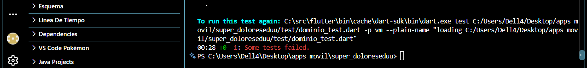
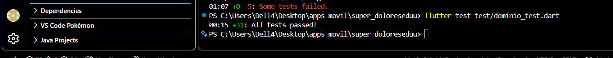
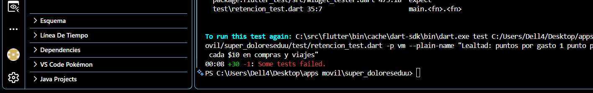
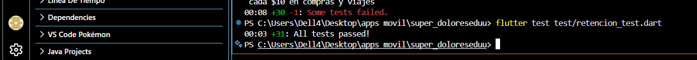
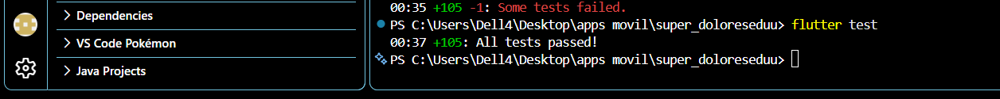

Super Dolores - Ciclos de TDD (Rojo y Verde)

Descripción de cada paso del manual, en orden de ejecución, con la razón por la que cada prueba falla (rojo) o por la que el código mínimo la hace pasar (verde).

Paso 2.1 - Pruebas del dominio (ROJO)

La prueba falla porque test/dominio_test.dart importa dinero.dart, eventos.dart, excepciones.dart, mensajeria.dart, monedero.dart, plataforma.dart y transporte.dart, archivos que todavía no existen, por lo que ni siquiera compila. Aun si existieran, no estarían definidas funciones como formatearPesos, porcentaje o lunesDe, ni las clases Monedero o BusEventos. Las pruebas fijan de antemano las reglas del negocio: dinero en centavos, saldo como suma de movimientos, idempotencia, eventos aislados, permisos de las mini-apps y kill switch.

Paso 2.2 - Dinero, fechas y errores (VERDE)

Se crean dinero.dart y excepciones.dart con lo mínimo para el grupo "dinero y fechas". Pasa porque formatearPesos trabaja con centavos enteros, agrega comas con una expresión regular y maneja negativos; porcentaje calcula (centavos x pct + 50) ~/ 100, de modo que 9999 al 5% da 500 y 5600 da 280. lunesDe resta weekday - 1 días con DateTime(año, mes, día - n), así los siete días de una semana apuntan al mismo lunes sin que el cambio de horario mueva la fecha.

Paso 12.1 - Pruebas de servicios y de ViewModels (ROJO)

La prueba falla porque test/vms_test.dart importa inicio_vm.dart, monedero_vm.dart, chat_vm.dart, tienda_vm.dart, viajes_vm.dart y metricas_vm.dart, que aún no existen. Define lo que cada pantalla debe hacer: mostrar saldo, puntos y sugerencia, canjear puntos, enviar dinero con mensajes de error claros, armar el carrito conservándolo si no hay saldo, recorrer un viaje completo y calcular métricas reproducibles. En el mismo bloque, servicios_test.dart fija comercio, transporte y un día de uso que suma todos los bonos.

Paso 12.2 - ViewModels (VERDE)

Se escriben los seis ViewModels. Pasa porque InicioViewModel deriva saldo, puntos, nivel y sugerencia de la plataforma, y el resto recibe solo su ContextoMiniApp, de modo que las pantallas no pueden saltarse los permisos. Cada acción atrapa los errores y los convierte con mensajeSeguro, que muestra mensajes claros sin revelar detalles internos, y llama a alCambiar para refrescar el inicio. MetricasViewModel usa datos sintéticos con una semilla fija, por eso dos instancias dan los mismos números.

##todos los test cumplidos
